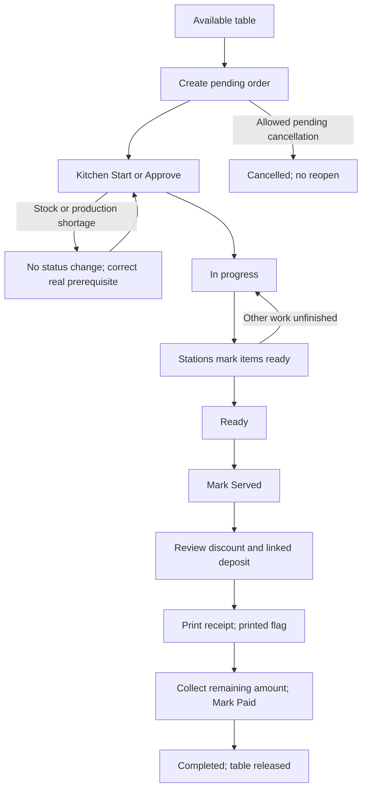

# Dine-in: table to kitchen, receipt, and final payment

**Roles:** Waiter or Manager for seating/order, Kitchen_manager for preparation, Cashier for collection; Admin/BranchAdmin for exceptions/discount authority. All use the same restaurant and appropriate active branch.

**Prepare:** available table, correctly priced menu, recipes/raw stock or prepared production, station assignments, and any real reservation/deposit. Sign in and select branch before creating records.

## Serve and settle a dine-in order

1. Waiter `/waiter` or Manager `/manager/tables`: open available table → **Start New Order**. If reservation applies, verify its active time and matching customer name/phone.
2. Select dishes/platters, quantities and line preparation notes; open cart; enter customer and optional phone/order note → **Create Order**. Result: pending order, immutable line price snapshots, occupied table, creator, number and notification. Matching reserved booking becomes arrived and links deposit.
3. Kitchen `/kitchen`: review routed items → **Start Preparing** / per-line **Approve**. Result: in_progress, prep-start timestamp and initial stock/production deduction. On shortage the status transaction rolls back; inventory/production operator resolves the true shortage before retry.
4. Kitchen finishes each assigned station’s work → **Ready** per line or **Mark as Ready** per order. Remaining work at any other station keeps overall in_progress. When all active items ready, order ready and prep-end time recorded.
5. Waiter delivers food → table **Mark Served**. Result served. Cashier queue also includes ready dine-in; if cashier prints before served, it asks to mark served first.
6. Cashier `/cashier`: **View** confirms items, deposit and remaining amount. If discount needed, request approved manual discount or apply valid card; refresh amount before collection.
7. **Print** → review receipt → browser print. Backend records printed flag. Printing alone leaves payment uncompleted.
8. Collect actual remaining balance → **Mark Paid** (enabled after print). Result completed, original receiving staff/paid time captured, table released and linked/matched reservation completed. Active cashier/kitchen queue removes final order.

## Alternative/correction paths

- Before kitchen approval, pending line quantities can be changed; dedicated line × sends immediate cancellation. Do not assume Save is needed to finalize that cancellation.
- **Add Item** creates new pending lines and deducts stock immediately. It may not reset an already-ready/served overall status in the same way initial kitchen work does. Check kitchen queue and movement ledger; see known discrepancy about additional-line deductions.
- **Change Table** moves a nonfinal dine-in order if target is free and permitted; waiter UI hides it for a current reservation. Reverse only by another permitted move.
- Waiter/Manager whole-order cancellation is pending-only. Admin exceptions still cannot reopen finalized orders. No automatic raw-stock refund is implemented for whole-order cancellation.
- Reservation prepayment reduces remaining collection, but there is no general partial customer-order payment form. Do not use Mark Paid for an intentionally partial amount.
- If two devices update at once, refresh; terminal guards prevent stale kitchen/items/table changes from reopening a paid order. Repeated completed payment leaves original receiver/time intact.
- Approved manual discount on completed order is an existing exception that can change amount without refund handling. Escalate it; never claim automatic refund occurred.

Sources and detailed steps: [order entry](../forms/order_entry.md), [waiter tables](../modules/orders/waiter_tables.md), [preparation](../modules/kitchen/preparation.md), [cashier](../modules/billing/cashier.md), [reservations](../modules/reservations/reservations.md), [verification register](../troubleshooting/verification_register.md).
