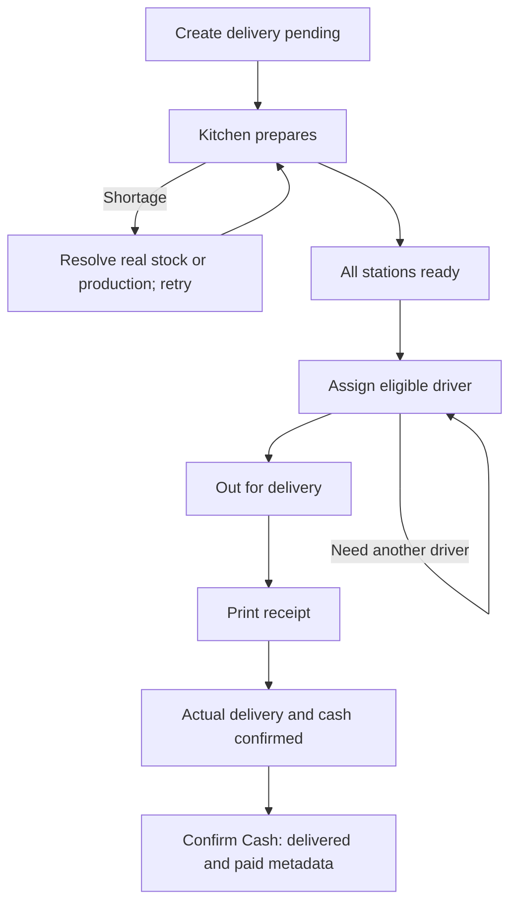

# Takeaway and delivery: create, prepare, hand over, and settle

## Takeaway

1. Cashier `/cashier` → **+ TakeAway** → `/cashier/takeaway`. Build cart, enter Customer Name and optional phone/note, **Create Order**.
2. Kitchen starts/approves pending work; stock/production is checked and deducted as described in kitchen guide.
3. Kitchen marks items/order ready. Takeaway queue includes pending/in-progress orders but **Print** and payment controls are hidden until preparation progresses out of those states.
4. Cashier **View** checks lines/amount; finish discount before payment if needed. **Print** records receipt flag and opens printing.
5. Collect full remaining amount and hand over food → **Mark Paid**. Result `completed`, paid timestamp/receiver captured. Current UI does not require a separate `picked_up` transition despite that status existing in model choices/comments.

Pending takeaway can be cancelled from card confirmation; pending lines can be corrected/cancelled or extra lines added from Edit. No partial customer payment/refund/undo flow is provided. Do not mark paid based solely on paper receipt.

## Staff-created delivery

1. Cashier **+ Delivery** `/cashier/delivery` or Call_operator home `/call-operator`. Enter customer, phone, address, distance km and optional note; choose cart lines; **Create Order**. Delivery settings/minimum/radius are prerequisites.
2. Backend computes fee from effective branch/restaurant settings, stores pending order; kitchen prepares through same stock/station flow. Pending delivery is not in normal cashier delivery queue.
3. Ready delivery enters cashier queue. Review actual recipient/address/remaining amount and any approved discount/card.
4. **Assign** → select branch-assigned DeliveryBoy. **Assign Only** saves; send/assign saves then opens WhatsApp for operator-controlled sending. Ready becomes `out_for_delivery`. Reassign before finalization if necessary; no automatic physical driver tracking exists.
5. **Print** receipt; printed flag enables **Confirm Cash**. Make sure driver has correct details. WhatsApp or a printed receipt is not proof of delivery/payment.
6. After customer delivery and actual cash handover/collection is confirmed, cashier **Confirm Cash**. Result `delivered` terminal, receiver/paid time captured, order removed from active delivery queue. There is no required intermediate delivered→completed transition in this UI.

## Customer-created alternatives and failure recovery

Web/mobile customer checkout uses customer identity/coordinate/address/quote APIs instead of staff distance entry. Its accepted order joins downstream kitchen/cashier operations. Legacy public cancellation has a two-minute/status rule; customer marketplace cancellation differs. Use [customer handoff](../modules/public_ordering/customer_handoff.md) rather than promising one cancellation policy for all clients.

If assignment succeeds but WhatsApp fails, inspect assignee; do not repeat assignment just to resend text. If payment/finalization response is uncertain, refresh order history and paid timestamp before retry. Stock shortages block preparation; disabled Print/Mark Paid is often a state/print prerequisite, not lack of cashier role. Finalized delivery cannot be reassigned, edited, cancelled or reopened through ordinary UI.

See [order entry](../forms/order_entry.md), [cashier](../modules/billing/cashier.md), [requests](../modules/discounts/requests.md), and [errors and recovery](../troubleshooting/errors_and_recovery.md).
